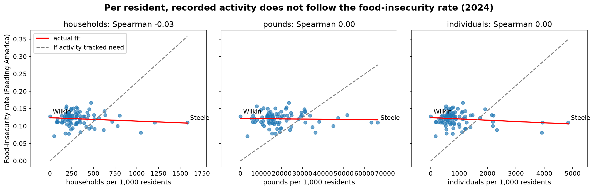
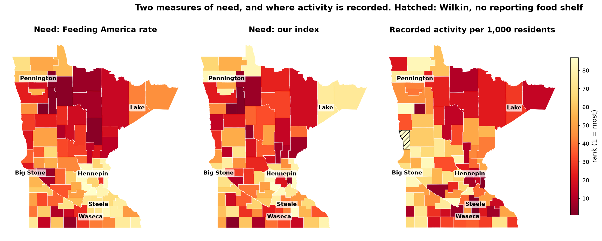

# Food-Shelf Need vs. Recorded Demand in Minnesota (MinneMUDAC 2026)

Graduate-division entry to MinneMUDAC 2026, the Minnesota data analytics competition
run by MinneAnalytics. The sponsor, The Food Group, provided 55 months (January 2022 to
July 2026) of monthly reports from every food shelf in its Minnesota network and asked
six questions about need, demand, prices, SNAP, forecasting and food access.

Team **Data Detectors**, three students. This folder holds
**my part of the work**: the shared data pipeline, Question 1 (does recorded activity
track need?) and Question 6 (a falsifiable measure of need and where it diverges from
recorded activity). The team's full repository is private because it contains the
sponsor's data. Submitted 17 October 2026.

## The question in one sentence

Food shelves report how many households they serve. Feeding America estimates how many
people are food insecure. Across Minnesota's 87 counties, do those two agree, and where
they do not, why?

## What I found

**Counts agree with need; rates do not (Q1).** A county with ten times the food-insecure
people records about sixteen times the activity: log-log slope 1.15 to 1.24 across three
metrics and three years, every confidence interval above 1, R² 0.84 to 0.88. Per 1,000
residents, however, recorded activity is uncorrelated with the food-insecurity rate
(Spearman −0.03 to 0.17). Pounds distributed tracks need best and households served
worst, by a small, consistent margin. Four county characteristics the brief names
(distance to a site, rurality, no-vehicle households, SNAP households) explain 3% of the
mismatch. Three spatial tests (Moran's I, join counts, a pooling test) find no border
pattern among the mismatched counties.

**A falsifiable measure of need (Q6).** Before touching the data I wrote down a
definition that a survey could prove wrong: *a household is in need if, at any point in
the past year, it worried about running out of food, regardless of whether it sought
help* (the first item of the USDA food-security questionnaire). The county measure is an
equal-weight index of seven public inputs, each chosen because it is measurable at zero
demand and is not an input to Feeding America's model: SNAP households, no-vehicle
households, senior poverty, housing-cost burden, adults without a diploma, low-income
low-access share, and debt in collections. As a test, I predicted one county's rank
before the index existed (Wilkin, about the 70th percentile); it landed at the 71st. The
top seven counties on need hold under every alternative weighting tried.

**Where need and activity diverge, and why.** The index agrees broadly with Feeding
America (Spearman 0.77) but differs on five of the top ten, and neither predicts recorded
activity per resident. Head to head, county population alone explains 85% of recorded
activity and neither measure of need adds more than a point of R². Two barriers explain
the divergence: households without home internet (+0.41 SD, p = 0.005) and distance to
the nearest site (+0.23 SD, p = 0.025), 17% of the variance. The through-line of the
team's deck: *recorded activity follows population and sites; need, measured either way,
barely moves it.*

## Methods

- **Pipeline** (`src/`): cleaning of the sponsor's site-level file into site-month and
  county-month panels, a food-shelf-type flag per site, a county covariate table built
  from Census ACS 5-year tables (B22003, B08201, B17001, B25070/B25091, B15003, B16002,
  B28002, B05001), the USDA Food Access Research Atlas, USDA rural-urban codes, the Census
  county adjacency file and the Urban Institute's Debt in America. Every public source is
  registered with publisher, exact series, grain and reason in `docs/DATA_SOURCES.md`.
- **Q1**: log-log OLS of activity on food-insecure persons per county-year; residual
  ranking; covariate model with errors clustered by county; Moran's I with permutation p,
  join counts and a pooling test against random county groupings.
- **Q6**: pre-registered definition and rejection criteria (`questions/q6_divergence_measure/addendum.md`);
  within-year z-scores, equal weights; divergence as need rank minus activity rank;
  stability under alternative weightings and random (Dirichlet) weights; barrier
  regression with clustered errors; nested models against Feeding America's rate.
- **Discipline**: a prediction written before every result; the organizers' leakage rule
  (nothing dated August 2026 enters the repository) enforced at download time.

## What is here and what is not

| here | not here |
|---|---|
| `questions/q1_need_vs_activity/`: README with the answers, `analysis.py` that rebuilds every number | the sponsor's site-level data and anything derived from it at county level (`data/`, residual rankings, per-county activity) |
| `questions/q6_divergence_measure/`: README, `analysis.py`, the graduate addendum written before the index existed | the team's Q4, Q5, Q7 and Q8 work (teammates) |
| `src/`: the pipeline modules I wrote | the August 2026 forecast submission |
| `docs/`: glossary and the public data-source registry | |
| `figures/`, `tables/`: model summaries (fits, correlations, covariate and barrier models, stability, index vs. Feeding America) and the need index built from public inputs | |
| `notebooks/q6_exploration.ipynb`: the Q6 working notebook, outputs cleared | |
| `deck_MinneMUDAC_2026_Data_Detectors.pdf`: the team's presentation | |

The scripts will not run from this folder: they expect the sponsor's data under `data/`.
They are here to show how the numbers were produced.

## Tools

Python (pandas, statsmodels, geopandas, matplotlib), Census API, Git.
